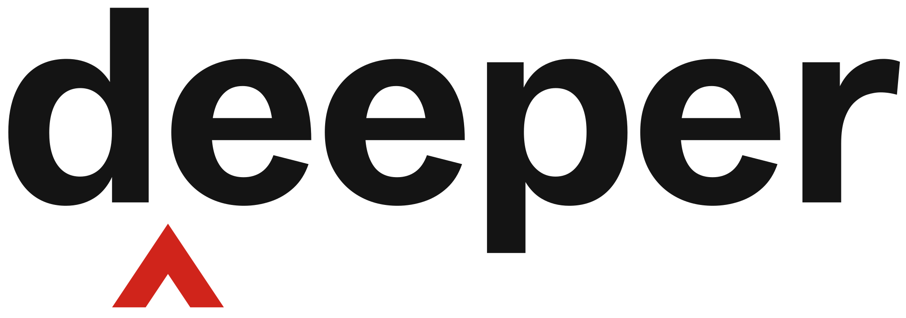
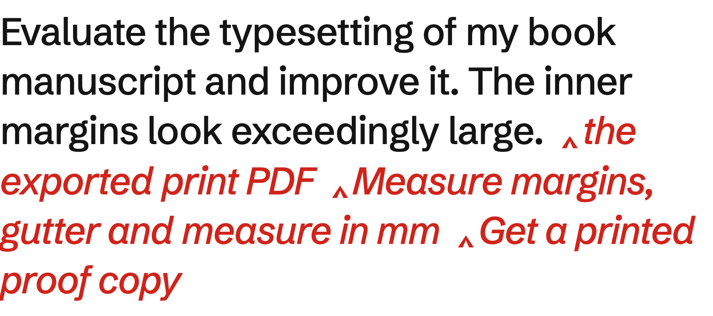

<p>
  <picture>
    <source media="(prefers-color-scheme: dark)" srcset="brand/assets/wordmark-dark.svg">
    
  </picture>
</p>

**Ask for the version an expert would ask for.** deeper is a free skill for coding agents such as Claude Code and Codex. It rewrites your task with the method, sources and checks a top professional would use. It keeps your scope and asks before running.

```bash
npx skills add EazyAccessEA/deeper
```

Then type `/deeper` and your task.

<picture>
  <source media="(prefers-color-scheme: dark)" srcset="brand/assets/proof-dark.png">
  
</picture>

A real run. Red is what deeper inserted, word for word from its rewrite. Docs, the live demo and the test results are on [deeper.tools](https://deeper.tools).

## How it works

Before rewriting anything, deeper answers four questions about your task:

1. What would a top professional in this field do here that you haven't asked for?
2. What raw material would they start from? The data, files or originals, never a summary of them.
3. Which methods and tools would they use? Instruments, not vocabulary.
4. What would show the result is right, other than you or the model?

Then it writes one prompt in a code block and asks whether to run it. The prompt asks for the same deliverables you did. Anything else an expert would add goes on one line, "Worth knowing, not in this task", for you to choose.

- `/deeper <task>` deepens that task.
- `/deeper` on its own deepens the task already under discussion.
- If the task is too small for depth to matter, it says so in one line and stops.

## Install

**Any agent.** `npx skills add EazyAccessEA/deeper` asks which agents to install into. The [skills CLI](https://github.com/vercel-labs/skills) knows about seventy, Claude Code and Codex among them. Add `-g` to install for your user rather than one project.

**Claude Code plugin.**

```
/plugin marketplace add EazyAccessEA/deeper
/plugin install deeper@deeper
```

**By hand.** Copy `skills/deeper/SKILL.md` into a `deeper` folder: `~/.claude/skills/` for Claude Code, `~/.agents/skills/` for Codex, Cursor and others that read the shared folder.

**A chat app.** ChatGPT, Claude.ai and Gemini have no skills folder. Paste the contents of `skills/deeper/SKILL.md` into the chat, then type `/deeper` and your task. With no files to read, deeper asks you for the raw material.

**A fixed version.** The commands above follow `main`. To install an exact release, see [SECURITY.md](SECURITY.md).

## Does it work?

Five real tasks, with project details stripped out: a product caption, book typesetting, selling a car, moving an app off Vercel, tidying a Downloads folder. Each was rewritten with no skill, with deeper 1.0 and with deeper 1.1, then scored blind in one pass by a judge on a different model. Average out of 5:

| | No skill | deeper 1.0 | deeper 1.1 |
|---|---|---|---|
| Expert method | 2.6 | 4.6 | 5.0 |
| Starts from raw material | 1.8 | 4.8 | 5.0 |
| Check outside the model, with a pass mark | 1.0 | 3.8 | 4.8 |
| Kept to the original scope | 2.2 | 2.8 | 4.0 |
| Extra deliverables per task | 3.2 | 3.6 | 1.8 |

Version 1.1 exists because 1.0 grew tasks. In a sample of 40 of my own past runs, 33 asked for at least one deliverable I hadn't. A first fix kept scope but weakened method and checks, so the rule was rewritten and tested again; [`examples/raw/v1.1/`](examples/raw/v1.1/) has both rounds. The judge is a model, and the skill itself says that doesn't count as proof. It's one run on five tasks.

Tested in Claude Code. Installing into Codex and Cursor is tested; running inside them isn't yet. Reports welcome.

## Contact

- Questions and bugs: [open an issue](https://github.com/EazyAccessEA/deeper/issues).
- Anything private: hello@deeper.tools.
- Security problems: use the private form in [SECURITY.md](SECURITY.md), not a public issue.

## Related skills

**The source.** The four questions are Felix Rieseberg's, from the Depth section of [How to be more ambitious: A tutorial for humans with models](https://felixrieseberg.com/how-to-be-more-ambitious-a-tutorial-for-humans-with-models/) (13 October 2026). deeper turns that one prompt into a command, and adds the workspace check, the skills and agents list, the scope rule and the stop rule.

**be-ambitious** (mine, not published) grew out of deeper. It covers altitude, depth and range, adds hard targets and a list of what counts as finished, then does the work. Use deeper when you want to see and edit the prompt first, be-ambitious when you want the work done.

**[DannyMac180/skills@be-ambitious](https://github.com/DannyMac180/skills/tree/main/be-ambitious)** (MIT) is a separate skill built on the same prompt from the article. It behaves much like deeper: rewrite, then offer to run.

## Privacy

The skill sends nothing. It's a text file your agent reads, with no code and no network calls. If it suggests searching for other skills with `npx skills find`, it asks first.

The skills CLI has its own anonymous install telemetry, which is where the install count on skills.sh comes from. Turn it off with `DISABLE_TELEMETRY=1` or `DO_NOT_TRACK=1`. The site uses Cloudflare Web Analytics, which sets no cookies. The email form on the site stores your address, the signup date, your country, the page link you signed up from, and a SHA-256 hash of your IP with a secret salt and the date, which limits repeat signups and is cleared after a day. It sits in Cloudflare D1, and no email is sent from it until confirmation and unsubscribe are built. Records are deleted two years after the last email, or on unsubscribe. The full notice is at [deeper.tools/privacy](https://deeper.tools/privacy). `scripts/traffic-snapshot.sh` saves the repo's GitHub traffic to `data/traffic.csv`, because GitHub keeps only 14 days.

## The site

[deeper.tools](https://deeper.tools) is built with Astro from `site/`. Every score on it is read from `examples/raw/` at build time, so it can't drift from the evidence. Publish a change with `cd site && npm run build && npx wrangler deploy`.

## Licence

Apache 2.0. See [LICENSE](LICENSE) and [NOTICE](NOTICE).
